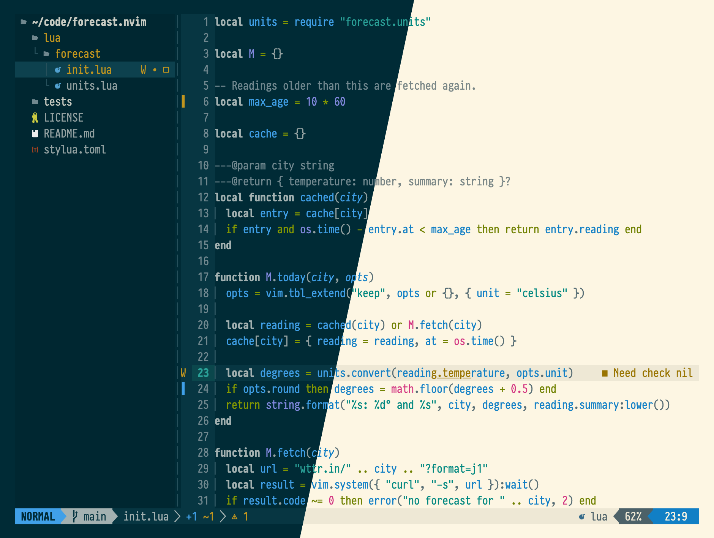

# Parhelion

A Neovim colorscheme that draws code in a modern take on [Solarized](https://ethanschoonover.com/solarized/), dark and
light, and gives plugin interfaces a quiet, consistent look of their own.



## Install

With lazy.nvim:

```lua
{
	"joaofnds/parhelion.nvim",
	name = "parhelion",
	lazy = false,
	priority = 1000,
	config = function()
		require("parhelion").setup {}
		vim.o.termguicolors = true
		vim.o.background = "dark" -- or "light"
		vim.cmd.colorscheme "parhelion"
	end,
}
```

Setting `background` and loading the colorscheme again switches modes. It needs Neovim 0.12 or later.

## Options

`setup` takes these, shown with their defaults:

```lua
require("parhelion").setup {
	transparent = false, -- clear the page's and the gutter's background
	dim_inactive = false, -- give windows without focus a dimmer surface
	bold = true,
	italic = true,
	overrides = {}, -- groups to change, or a function from the mode's colors to them
	plugins = {}, -- { ["telescope.nvim"] = false } leaves that plugin's groups to it
}
```

`:help parhelion` says what each one does, and how to load the theme files lualine, barbecue, bufferline, feline and
reactive use.

## Plugins

Highlight groups ship for these plugins:

- [stevearc/aerial.nvim](https://github.com/stevearc/aerial.nvim)
- [dense-analysis/ale](https://github.com/dense-analysis/ale)
- [goolord/alpha-nvim](https://github.com/goolord/alpha-nvim)
- [comfysage/artio.nvim](https://github.com/comfysage/artio.nvim)
- [avante-corp/avante.nvim](https://github.com/avante-corp/avante.nvim)
- [romgrk/barbar.nvim](https://github.com/romgrk/barbar.nvim)
- [utilyre/barbecue.nvim](https://github.com/utilyre/barbecue.nvim)
- [DanilaMihailov/beacon.nvim](https://github.com/DanilaMihailov/beacon.nvim)
- [saghen/blink.cmp](https://github.com/saghen/blink.cmp)
- [saghen/blink.indent](https://github.com/saghen/blink.indent)
- [saghen/blink.pairs](https://github.com/saghen/blink.pairs)
- [akinsho/bufferline.nvim](https://github.com/akinsho/bufferline.nvim)
- [francescarpi/buffon.nvim](https://github.com/francescarpi/buffon.nvim)
- [neoclide/coc.nvim](https://github.com/neoclide/coc.nvim)
- [nvim-zh/colorful-winsep.nvim](https://github.com/nvim-zh/colorful-winsep.nvim)
- [github/copilot.vim](https://github.com/github/copilot.vim)
- [kristijanhusak/vim-dadbod-ui](https://github.com/kristijanhusak/vim-dadbod-ui)
- [mfussenegger/nvim-dap](https://github.com/mfussenegger/nvim-dap)
- [rcarriga/nvim-dap-ui](https://github.com/rcarriga/nvim-dap-ui)
- [nvimdev/dashboard-nvim](https://github.com/nvimdev/dashboard-nvim)
- [sindrets/diffview.nvim](https://github.com/sindrets/diffview.nvim)
- [Bekaboo/dropbar.nvim](https://github.com/Bekaboo/dropbar.nvim)
- [famiu/feline.nvim](https://github.com/famiu/feline.nvim)
- [lambdalisue/vim-fern](https://github.com/lambdalisue/vim-fern)
- [j-hui/fidget.nvim](https://github.com/j-hui/fidget.nvim)
- [folke/flash.nvim](https://github.com/folke/flash.nvim)
- [junegunn/fzf](https://github.com/junegunn/fzf)
- [ibhagwan/fzf-lua](https://github.com/ibhagwan/fzf-lua)
- [isakbm/gitgraph.nvim](https://github.com/isakbm/gitgraph.nvim)
- [airblade/vim-gitgutter](https://github.com/airblade/vim-gitgutter)
- [lewis6991/gitsigns.nvim](https://github.com/lewis6991/gitsigns.nvim)
- [MagicDuck/grug-far.nvim](https://github.com/MagicDuck/grug-far.nvim)
- [ThePrimeagen/harpoon](https://github.com/ThePrimeagen/harpoon)
- [lukas-reineke/headlines.nvim](https://github.com/lukas-reineke/headlines.nvim)
- [smoka7/hop.nvim](https://github.com/smoka7/hop.nvim)
- [RRethy/vim-illuminate](https://github.com/RRethy/vim-illuminate)
- [lukas-reineke/indent-blankline.nvim](https://github.com/lukas-reineke/indent-blankline.nvim)
- [nvimdev/indentmini.nvim](https://github.com/nvimdev/indentmini.nvim)
- [folke/lazy.nvim](https://github.com/folke/lazy.nvim)
- [ggandor/leap.nvim](https://github.com/ggandor/leap.nvim)
- [ggandor/lightspeed.nvim](https://github.com/ggandor/lightspeed.nvim)
- [tamago324/lir.nvim](https://github.com/tamago324/lir.nvim)
- [nvimdev/lspsaga.nvim](https://github.com/nvimdev/lspsaga.nvim)
- [nvim-lualine/lualine.nvim](https://github.com/nvim-lualine/lualine.nvim)
- [OXY2DEV/markview.nvim](https://github.com/OXY2DEV/markview.nvim)
- [mason-org/mason.nvim](https://github.com/mason-org/mason.nvim)
- [nvim-mini/mini.nvim](https://github.com/nvim-mini/mini.nvim)
- [SmiteshP/nvim-navic](https://github.com/SmiteshP/nvim-navic)
- [nvim-neo-tree/neo-tree.nvim](https://github.com/nvim-neo-tree/neo-tree.nvim)
- [NeogitOrg/neogit](https://github.com/NeogitOrg/neogit)
- [nvim-neotest/neotest](https://github.com/nvim-neotest/neotest)
- [folke/noice.nvim](https://github.com/folke/noice.nvim)
- [vigoux/notifier.nvim](https://github.com/vigoux/notifier.nvim)
- [hrsh7th/nvim-cmp](https://github.com/hrsh7th/nvim-cmp)
- [rcarriga/nvim-notify](https://github.com/rcarriga/nvim-notify)
- [kylechui/nvim-surround](https://github.com/kylechui/nvim-surround)
- [nvim-tree/nvim-tree.lua](https://github.com/nvim-tree/nvim-tree.lua)
- [dchinmay2/nvim-ts-rainbow](https://github.com/dchinmay2/nvim-ts-rainbow) and [HiPhish/nvim-ts-rainbow2](https://github.com/HiPhish/nvim-ts-rainbow2)
- [kevinhwang91/nvim-ufo](https://github.com/kevinhwang91/nvim-ufo)
- [pwntester/octo.nvim](https://github.com/pwntester/octo.nvim)
- [stevearc/oil.nvim](https://github.com/stevearc/oil.nvim)
- [machakann/vim-sandwich](https://github.com/machakann/vim-sandwich)
- [stevearc/overseer.nvim](https://github.com/stevearc/overseer.nvim)
- [rlane/pounce.nvim](https://github.com/rlane/pounce.nvim)
- [HiPhish/rainbow-delimiters.nvim](https://github.com/HiPhish/rainbow-delimiters.nvim)
- [rasulomaroff/reactive.nvim](https://github.com/rasulomaroff/reactive.nvim)
- [MeanderingProgrammer/render-markdown.nvim](https://github.com/MeanderingProgrammer/render-markdown.nvim)
- [mhinz/vim-signify](https://github.com/mhinz/vim-signify)
- [folke/snacks.nvim](https://github.com/folke/snacks.nvim)
- [simrat39/symbols-outline.nvim](https://github.com/simrat39/symbols-outline.nvim)
- [nvim-telekasten/telekasten.nvim](https://github.com/nvim-telekasten/telekasten.nvim)
- [nvim-telescope/telescope.nvim](https://github.com/nvim-telescope/telescope.nvim)
- [folke/todo-comments.nvim](https://github.com/folke/todo-comments.nvim)
- [nvim-treesitter/nvim-treesitter-context](https://github.com/nvim-treesitter/nvim-treesitter-context)
- [folke/trouble.nvim](https://github.com/folke/trouble.nvim)
- [mbbill/undotree](https://github.com/mbbill/undotree)
- [justinmk/vim-sneak](https://github.com/justinmk/vim-sneak)
- [vimwiki/vimwiki](https://github.com/vimwiki/vimwiki)
- [folke/which-key.nvim](https://github.com/folke/which-key.nvim)
- [s1n7ax/nvim-window-picker](https://github.com/s1n7ax/nvim-window-picker)
- [gbprod/yanky.nvim](https://github.com/gbprod/yanky.nvim)

[DESIGN.md](DESIGN.md) says how far the tests reach for each.

## Documents

- [DESIGN.md](DESIGN.md): how a load works, plugin support and the test suite.
- [COLOR.md](COLOR.md): the color theory behind the palette, and every color parhelion changes.
- [GLOSSARY.md](GLOSSARY.md): the terms these documents use.
- [CHANGELOG.md](CHANGELOG.md): the changes a user can see.
- [doc/parhelion.txt](doc/parhelion.txt), or `:help parhelion` in Neovim: installation, options and plugin setup.

## Tests

`tests/parhelion/run.sh` runs the suite. [DESIGN.md](DESIGN.md) lists what it needs.

## License

MIT. See [LICENSE.md](LICENSE.md).
